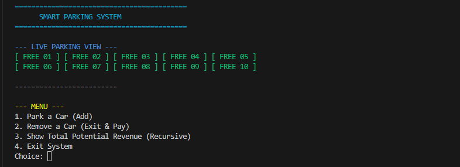
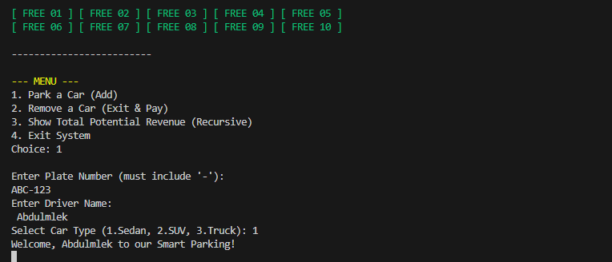
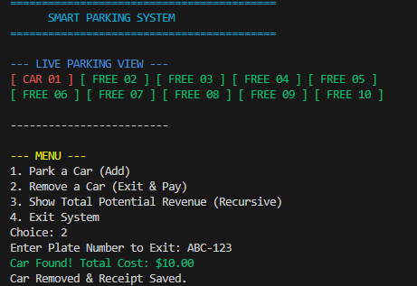
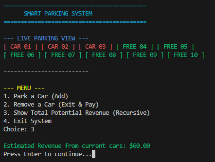

# Smart Parking Management System (C)

<p>
  
  
  
</p>

A console application written in C that replaces a paper parking log. The operator sets the lot capacity at start-up,
parks and removes cars, sees a live colour-coded view of every slot, and gets a receipt written to a file on exit.

## Features

- **Runtime capacity:** the number of slots (1-100) is entered at start-up and allocated with `malloc`; the memory is released with `free` on exit.
- **Live parking view:** green `FREE` and red `CAR` slots, five per row, redrawn after every action.
- **Parking a car:** the first free slot is found with a linear search. The plate is checked for a minimum length of 3 characters and must contain `-`.
- **Exit and billing:** the car is found by plate number (linear search with `strcmp`). The fee depends on the vehicle class: Sedan $10, SUV $20, Truck $30.
- **Receipts:** every exit appends a receipt to `receipt.txt`.
- **Revenue estimate:** a recursive function adds up the fees of all cars currently parked.

## C concepts demonstrated

| Concept | Where |
|---|---|
| Dynamic memory | `malloc` / `free` sized by the capacity the user enters (`main`) |
| Enumeration | `CarType { SEDAN = 1, SUV, TRUCK }` |
| Structures and bit-fields | `ParkingSlot`, and `Status { isOccupied : 1; hasPaid : 1 }` |
| Pointers and arrays | a `ParkingSlot *` is passed to every function |
| Recursion | `calculateRevenueRecursive()` |
| String handling | `strlen`, `strchr`, `strcmp`, `strcpy`, `strcat` |
| File I/O | `fopen(..., "a")` in `saveReceipt()` |
| Time | `time(NULL)` stores the entry timestamp |
| Portability | `#ifdef _WIN32` chooses `cls` or `clear`; ANSI escape codes for colour |

## Screenshots

<table>
  <tr>
    <td align="center"><br><sub>Start-up: ten free slots</sub></td>
    <td align="center"><br><sub>Parking a car (plate validation)</sub></td>
  </tr>
  <tr>
    <td align="center"><br><sub>Exit, fee and receipt</sub></td>
    <td align="center"><br><sub>Recursive revenue estimate</sub></td>
  </tr>
</table>

## Build and run

```bash
gcc -std=c11 -Wall -Wextra smart_parking_system.c -o smart_parking
./smart_parking
```

Verified with GCC 13.3 (no warnings with `-Wall -Wextra`). On Windows, run `smart_parking.exe` in a terminal that supports ANSI colours
(Windows Terminal or the VS Code terminal).

A receipt in `receipt.txt` looks like this:

```text
--- RECEIPT ---
Driver: Ali
Plate: ABC-123
Cost: $20.00
---------------
```

## Known limitations and next steps

- [ ] **Time-based pricing:** the entry time is stored (`time_t`) but the fee currently depends only on the vehicle class.
- [ ] **Safer input:** `scanf("%s")` has no width limit and names with spaces are not supported; `fgets` or `%19s` / `%49s` would fix both.
- [ ] **Validate the car type** (only 1-3 are meaningful) before it is stored.
- [ ] **Use or remove** the `hasPaid` flag, which is defined but not used yet.
- [ ] **Persistence:** parked cars are not saved between runs; only receipts are.

## Repository contents

- [`smart_parking_system.c`](smart_parking_system.c) &mdash; the complete source code.
- [`Project Report_Smart Parking Management System.pdf`](Project%20Report_Smart%20Parking%20Management%20System.pdf) &mdash; full report with objectives, function list, flowcharts and input/output screenshots.
- [`docs/images/`](docs/images/) &mdash; screenshots used in this README.

## About

Course project for *Computer Programming 1*, Department of Mechatronics Engineering, Faculty of Engineering, University of Sana'a.

**Author:** Abdulmlek Al-Sharee &mdash; [@abdulmlekalsharee-create](https://github.com/abdulmlekalsharee-create)
